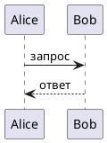
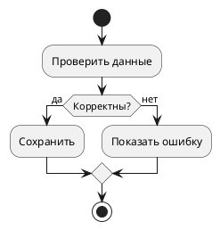
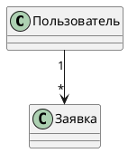

# Написание глав под md-gost

Текст проходит три сита. Сборка проверяет синтаксис и падает на битой ссылке,
дублирующейся метке или таблице без подписи. Линтер `packages/md-gost-lint` проверяет
механическую часть правил ниже и тоже останавливает сборку — в скобках у
каждого правила стоит его код (`STRUCT001` и подобные). Всё остальное —
связность, уместность вывода, точность формулировок — не проверяет никто,
кроме автора: документ, прошедший обе проверки, ещё не значит «написан
правильно».

Синтаксис разметки (метки, подписи, `book.toml`, стили, рамка) описан в
`packages/md-gost-build/README.md`, перечень правил линтера и их настройка — в
`packages/md-gost-lint/README.md`. Оба — источники истины, сюда они не копируются.

## Структура раздела

**Раздел не может состоять из одной таблицы** (`STRUCT003`). Подраздел, в
котором нет ничего, кроме таблицы, рисунка или списка, — пустой: читатель видит
данные, но не видит вывода, ради которого их собрали. Такой подраздел либо
дополняют абзацем с разбором (что из таблицы следует, чем строки различаются,
что выбрать и почему), либо объединяют с соседним, у которого текст есть.
Подпись к таблице разбором не считается: она называет данные, а не объясняет
их.

**Раздел не кончается таблицей или рисунком** (`STRUCT001`). Последним всегда
идёт текст — хватит одного предложения с выводом («для типовой ИС это
означает…», «на практике комплект сводят к…»). Таблица или рисунок в конце
обрывают изложение: читатель остаётся с данными без итога, а следующий
заголовок начинается «с нуля».

Заканчивать раздел списком тоже не стоит (`STRUCT002`): перечисление
закрывают связным абзацем. Короткому документу правило можно выключить
в его `mdlint.toml` рядом с `book.toml`.

## Заголовки

Завершающий раздел работы называется **«Заключение»**, не «Выводы»
(`STRUCT007`): «Выводы» читается как подзаголовок внутри главы, а «Заключение»
— принятое название завершающего раздела пояснительной записки. Пишется
без номера, на том же уровне, что и разделы работы: `## Заключение` там, где
разделы лежат на втором уровне, `# Заключение {-}` — в работе с автонумерацией.
Нумерованные пункты внутри него оставляют как есть.

**Структурные элементы работы не нумеруются** (`STRUCT009`). «Содержание»,
«Введение», «Заключение», «Список использованных источников» и им подобные —
не разделы, а части работы, поэтому номер им не присваивают: `## Заключение`,
а не `## 8 Заключение`. Сквозная нумерация идёт только по содержательным
разделам, и её счёт от этого не сбивается — если последний раздел был
седьмым, заключение просто идёт после него без номера. Правило исправляется
автоматически.

**После номера раздела точка не ставится** (`STRUCT008`): `## 1 Название`,
`### 1.2 Название`, а не `## 1.` и `### 1.2.`. Точка отделяет номер от текста
в перечислении, в заголовке она лишняя. Правило исправляется автоматически:
`md-gost lint --fix <каталог работы>`.

## Оформление текста

**Жирный шрифт в основном тексте не применяется** (`STYLE001`). `**…**`
допустимо только в заголовках и в шапке таблицы (все её строки и так делаются
жирными автоматически, размечать их не нужно). Внутри абзацев,
списков, подписей и ячеек таблиц выделять слова жирным нельзя — акцент передают
формулировкой или отдельным заголовком.

Длинное тире `—` писать можно свободно: сборка сама заменит его на короткое `–`.

## Таблицы

**Номер строки не вписывают в ячейку с текстом** (`STYLE006`). Запись
`| 1. Формирование требований |` смешивает в одной графе номер и название:
по такой таблице нельзя сослаться на строку, а при вставке строки в середину
нумерацию приходится править руками. Если нумерация нужна — под неё заводят
отдельную первую колонку «№», если не нужна — номер убирают совсем.

## Листинги кода

Листинг — вложение наравне с таблицей и рисунком: его вводят предложением
(«точка входа приведена в листинге [@lst:handler]»), а после кода пишут, что из
него следует. Раздел листингом не кончается (`STRUCT001`), и номер в тексте не
набирается руками (`REF007`).

Подпись листингу даёт `caption="…"`, ссылку — метка `#lst:label`:

````markdown
```{.python #lst:handler caption="Обработчик HTTP-запросов"}
def handle(request):
    return Response(200)
```
````

Блок кода **без** подписи и метки листингом не считается и номера не получает —
так и оформляют команду запуска или фрагмент конфигурации, на которые не
ссылаются. Решает не размер фрагмента, а то, ссылается ли на него текст.

В листинг кладут тот минимум кода, который обсуждается в тексте: целый модуль
на две страницы выносят в приложение или вставляют диапазоном строк
(`file="src/handler.py" lines="11-25"`), а не переносят в главу целиком.

## Формулы

Формула — часть предложения, а не вставка между абзацами. Её вводят текстом
(«интегральный показатель зрелости вычисляется по формуле [@eq:maturity]»), а
после формулы **расшифровывают обозначения** — экспликацией, начинающейся со
слова «где», в том же порядке, в каком символы идут в самой формуле:

```markdown
<!-- #eq:maturity -->

$$K_{з} = \frac{\sum_{i=1}^{n} w_i x_i}{\sum_{i=1}^{n} w_i}$$

где $w_i$ — вес i-го критерия;
$x_i$ — оценка i-го критерия.
```

Экспликация пишется **одним абзацем**: строки внутри разделяются переводом
строки, а не пустой строкой (`EQ004`). Сборка раскладывает её под формулой так,
как требует ГОСТ: «где» в отдельной колонке, обозначения — на одной вертикали,
текст расшифровок выровнен по ширине.
Разбитая на абзацы, она этого выравнивания не получит.

Раздел не кончается формулой (`STRUCT001`): формула — такое же вложение, как
таблица, после неё идёт хотя бы одно предложение с выводом. Экспликация выводом
не считается — она называет символы, а не объясняет результат.

Номер формулы, как и номер рисунка, **не набирается руками** (`EQ003`): его
проставляет сборка, а в тексте пишется `[@eq:label]` → «(1)». Метка нужна
только для ссылки — номер формула получает в любом случае, поэтому формулу, на
которую никто не ссылается, метить незачем.

Обозначение в строке текста («значение $K_{з}$ сравнивается с пороговым»)
набирается одиночными `$` и остаётся в абзаце. Выключную формулу `$$…$$` пишут
отдельным блоком, с пустой строкой до и после: набранная внутри абзаца, она
останется в строке текста и номера не получит (`EQ002`).

## Перекрёстные ссылки

Ссылку оформляют оборотом внутри предложения — «приведено в таблице
[@tbl:label]», «показано на рисунке [@fig:label]», — а не скобочной пометкой в
конце фразы «(таблица [@tbl:label])»: скобка читается как служебная помета и
выпадает из связного текста (`STYLE002`).

Номера разделов задаёт манифест. По умолчанию их набирают в заголовке
(`## 1.2 Требования`). Если в `book.toml` включено `number_sections = true`,
номеров в исходнике нет: сборка проставляет их сама, а «Введение»,
«Заключение» и название документа помечают `{-}`. Ручной номер при
включённой автонумерации прерывает сборку.

Номера рисунков и таблиц **никогда не набираются руками** (`REF007`). Нумерация
сквозная и проставляется при сборке, поэтому вписанное в текст «Рисунок 3»
разъедется при первой же вставке диаграммы выше. Подписи тоже не пишутся
вручную — их формирует фильтр из `caption=` и маркеров `<!-- #tbl:… -->`.

Ссылки на главы («в главе 4») — обычная проза, метками не размечаются.

## Библиография

- `[@bib:key]` ставится в конце предложения, непосредственно **перед** точкой,
  а не в середине фразы: `…в организации [@bib:urintsov].` (`BIB001`)
- Не больше одной ссылки `[@bib:…]` на абзац (`BIB002`).
- Источники объявляют маркерами `#bib:`, обычно в отдельной главе вроде
  `REFERENCES.md`, подключённой в `chapters`.
- Если в манифесте одна глава и `toc = false`, линтер считает документ
  лабораторной и предупреждает о каждой ссылке `[@bib:…]` (`BIB003`).

## Иллюстрации

Диаграмму вставляют inline-блоком ` ```plantuml ` или отдельным файлом
`{#fig:label}`. Файл уместен, когда диаграмма
большая, переиспользуется или тянет за собой `!include`. Подпись в этой
форме задаётся alt-текстом, а не `caption="…"`: прямые кавычки в тексте
главы ловит `TYPO002`. Растровое изображение вставляют так же:
`{#fig:label}`.

### Виды диаграмм PlantUML

PlantUML поддерживает UML-диаграммы и несколько видов схем и графиков. Выбирать
тип следует по тому, что нужно показать; краткие примеры ниже — ориентиры, а не
полный справочник синтаксиса.

- **Поведение:** последовательностей — `Alice -> Bob: запрос`; вариантов
  использования — `actor Пользователь` и `Пользователь --> (Войти)`; активности —
  `start`, `:Проверить данные;`, `stop`; состояний — `[*] --> Ожидание`;
  временные — участники и события на шкале времени.
- **Структура:** классов — `class Пользователь` и `Пользователь --> Заявка`;
  объектов — `object user` и `user --> order`; компонентов — `[Веб-клиент] -->
  [Сервис]`; развертывания — `node Сервер { artifact Приложение }`; ER-модели —
  `entity CUSTOMER { *id : number }` и связи; сетевых схем — `cloud Интернет`
  и `node Сервер`.
- **Другие схемы и представления:** Gantt (`@startgantt`, задачи и длительности),
  mind map (`@startmindmap`, узлы `*` и `**`), WBS (`@startwbs`, дерево задач),
  JSON (`@startjson`), YAML (`@startyaml`), wireframe-интерфейсы (`@startsalt`,
  таблица-подобная форма) и ArchiMate (`@startuml` с библиотекой ArchiMate).
- **Графики:** столбчатые (`bar`), линейные (`line`) и точечные (`scatter`)
  диаграммы используют отдельный блок `@startchart`.

Короткие примеры:








Для остальных типов ориентироваться на эти формы начала блока и искать
официальную документацию по нужному виду схемы: [PlantUML — список типов и
примеры](https://plantuml.com/). Сверять актуальный синтаксис, ограничения и
поддержку рендерером до написания сложной диаграммы; не переносить команды из
одного типа диаграммы в другой. Если документация или пример неясны, искать
именно нужную страницу PlantUML (например, `chart-diagram`, `activity-diagram`,
`deployment-diagram`) и проверять минимальный пример сборкой документа.

Путь к файлу пишется относительно каталога работы — того, где лежит
`book.toml`. Что файл на месте, проверяет `REF010`, а что на месте каждый
`!include` внутри него — `REF011`; оба резолвят пути так же, как сборка,
поэтому битую ссылку видно до запуска pandoc.

## Перед сборкой

Прогнать линтер по изменённой работе:

```bash
md-gost lint <каталог работы или файл>
```

Ошибки (`error`) прерывают сборку и правятся всегда. Предупреждения
(`warning`) требуют решения: либо править текст, либо отключить правило в
`mdlint.toml` самой работы (файл рядом с её `book.toml` переопределяет
корневой) — но отключать стоит правило, неверное для всей работы, а не
неудобное в одном месте.

Затем перечитать изменённые разделы глазами: линтер видит, что после таблицы
стоит абзац, но не видит, есть ли в этом абзаце вывод. Формальное «данные
приведены выше» правило удовлетворяет, а раздел — нет.
