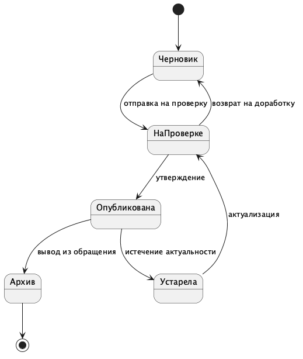

# Глава 1. Анализ предметной области

## 1.1 Постановка задачи

В этом разделе рассматриваются требования к системе. Маркированный список:

- первый пункт перечисления;
- второй пункт перечисления;
- третий пункт перечисления.

Нумерованный список:

1. подготовка данных;
2. построение модели;
3. оценка результата.

## 1.2 Диаграмма вариантов использования

```{.plantuml #fig:usecase caption="Диаграмма вариантов использования"}
left to right direction
actor Пользователь as U
rectangle Система {
  usecase "Войти" as UC1
  usecase "Просмотр отчёта" as UC2
}
U --> UC1
U --> UC2
```

Как показано на рисунке [@fig:usecase], пользователь взаимодействует с системой
через два основных сценария.

## 1.3 Сравнение инструментов

<!-- #tbl:tools Сравнение CASE-инструментов -->

| Инструмент   | Лицензия     | Поддержка UML   |
| ------------ | ------------ | --------------- |
| Tool A       | свободная    | полная          |
| Tool B       | проприет.    | частичная       |

Сводные данные приведены в таблице [@tbl:tools]. Подпись к таблице выровнена
по левому краю без абзацного отступа, как требует ГОСТ.

## 1.4 Снимок экрана системы

{#fig:screen}

Интерфейс системы представлен на рисунке [@fig:screen].

## 1.5 Схема развёртывания

{#fig:deploy}

Состав узлов приведён на рисунке [@fig:deploy]. Исходник диаграммы хранится
отдельным файлом и подключает общее оформление, поэтому в тексте главы остаётся
только ссылка на него.

## 1.6 Обработчик запросов

Точка входа в обработчик приведена в листинге [@lst:handler].

```{.python #lst:handler caption="Обработчик HTTP-запросов"}
def handle(request):
    payload = json.loads(request.body)
    return Response(200, payload)
```

Обработчик разбирает тело запроса и возвращает ответ с кодом 200. Служебный
метод проверки живости показан в листинге [@lst:health]: его текст берётся
прямо из файла, поэтому расходиться с исходниками он не может.

```{.python #lst:health file="src/handler.py" lines="12-13" caption="Проверка живости"}
```

Метод отвечает на запросы мониторинга и в разборе запроса не участвует.

## 1.7 Оценка зрелости

Интегральный показатель зрелости процессов вычисляется по формуле [@eq:maturity].

<!-- #eq:maturity -->

$$K_{з} = \frac{\sum_{i=1}^{n} w_i x_i}{\sum_{i=1}^{n} w_i}$$

где $w_i$ — вес i-го критерия;
$x_i$ — оценка i-го критерия по пятибалльной шкале;
$n$ — число критериев оценки.

Формула набирается в LaTeX между двойными знаками доллара. Номер сборка
проставляет сама и выравнивает его по правому краю строки.

## 1.8 Планирование работ

Плановые и фактические результаты анализа приведены в таблице [@tbl:plan].

<!-- #tbl:plan План и факт по этапам -->

+--------------+------------------+---------------------+
| Этап         | Показатель       | Значение            |
|              |                  +----------+----------+
|              |                  | План     | Факт     |
+==============+==================+==========+==========+
| Анализ       | Интервью         | 10       | 12       |
|              +------------------+----------+----------+
|              | Требования       | 20       | 18       |
+--------------+------------------+----------+----------+

План интервью перевыполнен, а сбор требований требует дополнительного времени.

## 1.9 Анализ показателей системы

Для примера рассмотрим условные результаты оценки качества базы знаний в течение
четырёх кварталов. Динамика полноты и актуальности материалов представлена на
рисунке [@fig:quality-trends].

```{.plot #fig:quality-trends caption="Динамика показателей качества базы знаний"}
sns.set_theme(style="whitegrid", font="DejaVu Sans", font_scale=1.0)
fig, ax = plt.subplots(figsize=(7, 3.3))
quarters = ["I", "II", "III", "IV"]
sns.lineplot(x=quarters, y=[54, 63, 72, 82], marker="o", linewidth=2.5,
             markersize=8, color="#275D87", label="Полнота", ax=ax)
sns.lineplot(x=quarters, y=[48, 58, 67, 74], marker="s", linewidth=2.5,
             markersize=7, color="#D57B4B", label="Актуальность", ax=ax)
ax.set(xlabel="Квартал", ylabel="Оценка, %", ylim=(0, 100))
ax.legend(title=None, frameon=False, loc="upper left", ncol=2)
ax.grid(axis="x", visible=False)
sns.despine(ax=ax)
fig.tight_layout()
```

Оба показателя растут на протяжении года, при этом актуальность остаётся ниже
полноты. Вымышленные значения позволяют показать различие двух рядов на одном
графике.

Оценки по отдельным направлениям и кварталам представлены на рисунке
[@fig:quality-heatmap].

```{.plot #fig:quality-heatmap caption="Оценка направлений работы с базой знаний"}
sns.set_theme(style="white", font="DejaVu Sans", font_scale=1.0)
fig, ax = plt.subplots(figsize=(7, 3.2))
values = [[3.1, 3.5, 3.8, 4.2], [2.8, 3.2, 3.6, 3.9],
          [3.4, 3.6, 4.0, 4.3]]
sns.heatmap(values, annot=True, fmt=".1f", cmap="YlGnBu", vmin=1, vmax=5,
            linewidths=2, linecolor="white", cbar_kws={"label": "Оценка, баллы"},
            xticklabels=["I", "II", "III", "IV"],
            yticklabels=["Поиск", "Обновление", "Доступ"], ax=ax)
ax.set(xlabel="Квартал", ylabel="")
ax.tick_params(axis="y", labelrotation=0)
fig.tight_layout()
```

По условным данным, обновление материалов получает самую низкую оценку во всех
четырёх кварталах. Тепловая карта помогает быстро сопоставить направления и
увидеть изменение каждой оценки.

## 1.10 Использование базы знаний

Условное распределение запросов пользователей по направлениям за месяц показано
на рисунке [@fig:knowledge-requests]. График строится при сборке документа по коду из отдельного файла.

{#fig:knowledge-requests}

В примере чаще всего обращаются к поиску, а запросы на обновление встречаются
реже остальных. Значения на концах столбцов позволяют сравнить направления без
дополнительной таблицы.

## 1.11 Моделирование деятельности в IDEF0

Контекстная диаграмма на рисунке [@fig:idef-context] показывает границы функции: заявка поступает на вход, договор управляет работой, команда обеспечивает её выполнение, а результатом становится система.

```{.plot #fig:idef-context caption="Контекстная диаграмма разработки системы"}
diagram = idef0.Context(
    block=idef0.Block("A0", "Разработать\nсистему"),
    inputs=["Заявка", "Требования"], outputs=["Система", "Документация"],
    controls=["Договор", "Бюджет"], mechanisms=["Команда", "Инструменты"],
)
```

Функция A0 раскрыта на рисунке [@fig:idef-cascade] в виде трёх связанных процессов. Модель описывается данными; координаты блоков и стрелок рассчитывает библиотека IDEF0.

```{.idef0 #fig:idef-cascade caption="Декомпозиция разработки системы"}
block A1 : Анализ
block A2 : Разработка
block A3 : Передача

A1 -> A2 : Требования
A2 -> A3 : Версия системы
input -> A1 : Заявка
A3 -> output : Система
control -> * : Договор
mechanism -> * : Команда
control -> A1 : Нормативы
control -> A2 : Бюджет проекта
mechanism -> A2 : Разработчик
mechanism -> A3 : Тестировщик
control -> A1,A3 : План приёмки
```

Результат анализа передаётся в разработку, а версия системы — на передачу заказчику. Общие управление и механизм применяются ко всем трём блокам; индивидуальные стрелки показывают дополнительные воздействия и участников отдельных процессов, а групповая стрелка связывает два выбранных блока.

## Выводы по главе

Проведён анализ предметной области и выбран инструментарий.
